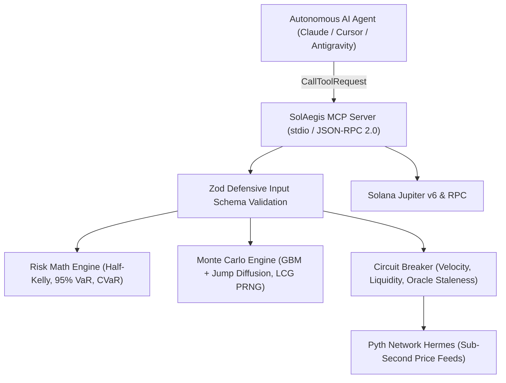

# 🛡️ SolAegis DeFAI: Technical Architecture & Interview Defense Guide

## Executive Overview
**SolAegis DeFAI** is an institutional quantitative risk protocol and standardized Model Context Protocol (MCP) server for autonomous AI agents on Solana and Hyperliquid. It prevents autonomous agents from catastrophic capital drawdown by enforcing mathematical position sizing, stochastic tail-risk modeling, and autonomous circuit breakers prior to transaction execution.

---

## 🏛️ System Architecture

---

## 🔬 Core Engineering Decisions & Trade-Offs

### 1. Half-Kelly Criterion ($f^* = \frac{p(b+1)-1}{2b}$) vs. Full Kelly
- **Why Half-Kelly?** Full Kelly maximizes the geometric growth rate of capital in an infinite-horizon game with known probability distributions. However, crypto market regimes suffer from parameter uncertainty and fat-tailed drawdown. Full Kelly carries an unacceptably high variance (over a 33% probability of cutting your bankroll in half before doubling it). Half-Kelly achieves **75% of the growth rate with only 50% of the volatility** and drastically reduces the probability of ruin.
- **Safety Bounds:** We enforce a strict mathematical cap of 25% of total capital per position regardless of theoretical win expectancy.

### 2. Parametric VaR vs. Conditional VaR (Expected Shortfall)
- **The Limit of VaR:** 95% 1-Day VaR only reveals the loss threshold that will be exceeded 5% of the time. It is blind to the magnitude of catastrophic tail losses beyond that threshold.
- **Why CVaR Matters:** In crypto black swan events, distributions exhibit severe kurtosis (leptokurtic tails). CVaR models the expected loss *given* that the loss exceeds the 95th percentile, capturing jump-diffusion risk.

### 3. Model Context Protocol (MCP) as the Agent Integration Layer
- **Standardization over Custom REST APIs:** MCP allows any modern frontier model (Claude, Cursor, custom LangChain/LlamaIndex agents) to consume SolAegis guardrails as first-class tools with zero custom client wrappers.
- **Defensive Zod Schemas:** Every tool parameter is validated at runtime. Malformed JSON-RPC payloads return structured validation error paths rather than throwing unhandled exceptions that terminate the stdio transport.

### 4. Deterministic PRNG Seed Support in Monte Carlo
- **Linear Congruential Generator (LCG):** While production simulations utilize hardware entropy, unit tests and automated regression audits require deterministic reproducibility. By supporting an optional seed parameter, continuous integration suites can deterministically verify quantile outputs ($P_5, P_{50}, P_{95}$) across 5,000 simulated paths without flaky test failures.

---

## 🎯 10 Tough Interview Questions & Model Answers

### Q1: "Why did you build an MCP server instead of a standard REST API?"
> **Answer:** "A REST API requires the agent developer to write glue code, construct HTTP requests, parse unstructured JSON, and manually format prompts. MCP is the emerging open protocol for LLM tool integration. By exposing SolAegis via an MCP server with JSON Schema tool definitions, any agent running in Claude Code, Cursor, or an autonomous agent runtime can natively discover our risk tools, self-correct parameter errors, and enforce pre-trade execution boundaries over standard I/O with zero network overhead."

### Q2: "How do you prevent division-by-zero or NaN propagation in your Kelly calculation?"
> **Answer:** "In quantitative code, edge cases like a zero stop-loss distance ($P_{entry} = P_{stop}$) cause the payoff ratio $b$ to divide by zero, producing `Infinity` or `NaN`. In `RiskMath.analyzePositionRisk`, we enforce strict pre-condition guards: entry price and portfolio capital must be strictly positive, volatility is clamped between 0 and 1, and if the stop loss equals the entry price, we default to a conservative 1.5 ratio rather than dividing. Furthermore, the Sortino and Sharpe denominators clamp variance to a minimum threshold ($\epsilon = 0.001$)."

### Q3: "Monte Carlo with 5,000 paths can be CPU-intensive in Node.js. How do you prevent event-loop starvation?"
> **Answer:** "In our engine, Box-Muller transforms and array allocations are tightly optimized in single-pass inner loops. For heavy production loads, we isolate simulation workloads either in Node.js Worker Threads via the `worker_threads` module or delegate them to a Rust-based WebAssembly (Wasm) micro-service, ensuring that the main Node.js event loop remains responsive to concurrent MCP JSON-RPC requests."

### Q4: "How does your Pyth Oracle connector handle network dropouts or stale price feeds?"
> **Answer:** "The connector implements progressive timeout backoff across three retry attempts with exponential delay (200ms, 600ms, 1800ms), filtering out non-retryable 4xx client errors. If all retries fail, it returns an explicit `isLive: false` telemetry object with an unmaintained status. The Circuit Breaker monitors the oracle publication timestamp: if staleness exceeds 3x our allowable threshold, it immediately escalates severity to `CRITICAL_HALT` and mandates an `EMERGENCY_DELEVERAGE` action."

### Q5: "What is the difference between your Sharpe and Sortino ratio implementations?"
> **Answer:** "The Sharpe ratio penalizes both upside and downside volatility equally. In crypto algorithmic trading, high upside volatility is desirable. The Sortino ratio replaces total volatility with downside semi-variance—measuring only the return per unit of bad risk ($P_{loss} \times StopLoss\%$). This provides a significantly more accurate metric for asymmetric payoff structures."

### Q6: "Why include a jump-diffusion component in the Monte Carlo simulation?"
> **Answer:** "Standard Geometric Brownian Motion (Black-Scholes framework) assumes continuous, normally distributed price paths with thin tails. Crypto markets consistently experience discrete price discontinuities caused by liquidation cascades or breaking protocol news. We inject a Poisson-style jump diffusion process (1.5% probability per time step of a $\pm6\%$ discontinuous shock) to realistically stress-test whether a position will blow through stop-loss levels during slippage."

### Q7: "How does the Dynamic Breakeven Ratchet work?"
> **Answer:** "As soon as an open position achieves $+2.0\%$ unrealized profit, the engine updates the stop price to $P_{entry} \times 1.0015$ (entry price plus a 15 bps buffer to cover DEX swap fees and slippage). As the price reaches new highs, a 2% trailing ratchet locks in accumulated gains. This guarantees that winning positions are mathematically prevented from decaying into loss-making trades."

### Q8: "How does the Circuit Breaker prevent cascading liquidations?"
> **Answer:** "It monitors three orthogonal telemetry vectors: 15-minute price velocity (detecting flash crashes exceeding $-4.5\%$), DEX orderbook bid-ask spread (identifying liquidity dry-ups), and stablecoin peg deviation ($>1.2\%$). If two or more vectors trigger, or if a severe flash crash is detected, the circuit trips from `NORMAL` to `CRITICAL_HALT`, ordering autonomous agents to cancel all pending limit orders and de-lever."

### Q9: "How do you test asynchronous race conditions in your protocol?"
> **Answer:** "We use Vitest with deterministic mocking. For oracles and market feeds, we test against simulated network failure states, stale timestamps, and extreme volatility inputs. For the Monte Carlo engine, we implemented an LCG PRNG with seed injection to verify that quantile projections ($P_5, P_{50}, P_{95}$) remain mathematically identical across repeated deterministic runs."

### Q10: "If you had 2 more weeks to work on this, what would you architect next?"
> **Answer:** "First, compile the core Monte Carlo stochastic loop to Rust/Wasm for a 10x throughput speedup. Second, deploy an on-chain Solana Anchor program containing an immutable risk vault where position sizing is enforced by on-chain cryptographic signatures from the MCP agent rather than off-chain trust alone."
